# FurFriends database (ERD)

The live Supabase database, as built by `supabase/migrations/`. Checked against the live project on
2026-10-20: all 12 tables exist, each account sees only its own rows, and visitors who aren't logged
in see nothing. Use this to check the ERD in the thesis manuscript. Every table, key and relationship
below should appear there.

```mermaid
erDiagram
    AUTH_USERS ||--|| PROFILES : "has"
    AUTH_USERS ||--o{ PETS : "owns"
    PETS ||--o{ MEDICAL_RECORDS : "has"
    PETS ||--o{ VACCINATIONS : "has"
    PETS ||--o{ DOCUMENTS : "has"
    PETS ||--o{ FEEDING_SCHEDULES : "has"
    PETS ||--o{ CARE_TASKS : "has"
    FEEDING_SCHEDULES ||--o{ FEEDING_LOG : "ticked as fed"
    PETS ||--o{ FEEDING_LOG : "has"
    AUTH_USERS ||--o{ ASSISTANT_FEEDBACK : "rates"
    PETS |o--o{ ASSISTANT_FEEDBACK : "asked about"
    AUTH_USERS ||--o{ PUSH_SUBSCRIPTIONS : "has devices"
    AUTH_USERS ||--o{ PUSH_LOG : "was sent"
    AUTH_USERS ||--o{ USABILITY_RESPONSES : "submits"

    AUTH_USERS {
        uuid id PK
        text email UK
        text encrypted_password
        timestamptz created_at
    }
    PROFILES {
        uuid id PK, FK "= auth.users.id"
        text name
        text phone
        text city
        boolean notifications_enabled
        timestamptz created_at
    }
    PETS {
        uuid id PK
        uuid owner_id FK "auth.users.id"
        text name
        text species "Cat or Dog"
        text breed
        smallint age_years
        smallint age_months "0 to 11"
        text gender "Female or Male"
        numeric weight_kg
        text photo_path "pet-photos bucket"
        timestamptz created_at
    }
    MEDICAL_RECORDS {
        uuid id PK
        uuid pet_id FK
        date date
        text type "Checkup, Illness, Injury, Surgery, Medication, Allergy, Other"
        text title
        text vet
        text notes
        timestamptz created_at
    }
    VACCINATIONS {
        uuid id PK
        uuid pet_id FK
        text name
        date date_given
        date next_due "after date_given"
        text vet
        text lot
        timestamptz created_at
    }
    DOCUMENTS {
        uuid id PK
        uuid pet_id FK
        text title
        text type
        date date
        text notes
        text file_path "pet-documents bucket"
        text mime_type "image or PDF"
        timestamptz created_at
    }
    FEEDING_SCHEDULES {
        uuid id PK
        uuid pet_id FK
        time time
        text food
        text amount
        smallint_array days "0 Sun to 6 Sat, empty = daily"
        text notes
        timestamptz created_at
    }
    FEEDING_LOG {
        uuid feeding_id PK, FK
        date fed_on PK
        uuid pet_id FK
    }
    CARE_TASKS {
        uuid id PK
        uuid pet_id FK
        text kind "Grooming, Deworming, Vaccination, Vet appointment"
        text title
        date next_due
        time due_time
        integer repeat_days "0 = once"
        date last_done
        boolean done
        text notes
        timestamptz created_at
    }
    ASSISTANT_FEEDBACK {
        uuid id PK
        uuid user_id FK
        uuid pet_id FK "null if general"
        text question
        text answer
        jsonb conversation
        jsonb pet_context
        text model
        smallint rating "1 or -1"
        text reason
        text comment
        timestamptz created_at
        timestamptz updated_at
    }
    PUSH_SUBSCRIPTIONS {
        uuid id PK
        uuid user_id FK
        text endpoint UK
        text p256dh
        text auth
        text timezone
        text user_agent
        timestamptz created_at
        timestamptz last_sent_at
    }
    PUSH_LOG {
        uuid user_id PK, FK
        text key PK
        timestamptz sent_at
    }
    USABILITY_RESPONSES {
        uuid id PK
        uuid user_id FK
        text participant_code
        text device
        jsonb tasks
        smallint_array sus "10 answers, 1 to 5"
        numeric sus_score "computed, 0 to 100"
        text liked
        text improve
        timestamptz created_at
    }
```

## Tables

| Table | One row is | Key | Belongs to |
|---|---|---|---|
| `auth.users` | a login (managed by Supabase Auth) | `id` | — |
| `profiles` | the owner's name, phone, city and reminder setting | `id` (same as the user's) | user, 1 to 1, made automatically at sign-up |
| `pets` | a cat or dog | `id` | user |
| `medical_records` | a checkup, illness, injury, surgery, medication or allergy | `id` | pet |
| `vaccinations` | a vaccine given, with its next due date | `id` | pet |
| `documents` | an uploaded photo or PDF (file kept in Storage) | `id` | pet |
| `feeding_schedules` | a meal time with food and amount | `id` | pet |
| `feeding_log` | a meal ticked as fed on one day | `feeding_id` + `fed_on` | feeding schedule (and pet) |
| `care_tasks` | a grooming, deworming or vaccination reminder, or a vet appointment | `id` | pet |
| `assistant_feedback` | a 👍/👎 rating of one assistant answer | `id` | user (and optionally pet) |
| `push_subscriptions` | a phone or browser that allowed notifications | `id` | user |
| `push_log` | a reminder already pushed, so it isn't sent twice | `user_id` + `key` | user |
| `usability_responses` | one tester's survey answers and SUS score | `id` | user |

## Rules worth showing in the manuscript
- **Deleting cascades.** Deleting an account deletes its profile, pets and everything below them.
  Deleting a pet deletes its records, files' rows, schedules, log and tasks. Ratings keep the
  question and answer but lose the pet link (`on delete set null`).
- **Privacy (Row Level Security).** Every table is locked to its owner: a pet's rows are visible only
  when the pet's `owner_id` is the logged-in user. Files are stored under `<user id>/<pet id>/…` and
  locked the same way.
- **Checks.** Species is Cat or Dog; months 0–11; weight above 0; a vaccine's next due date is after
  the date given; a rating is 1 or -1; the survey has exactly 10 answers from 1 to 5.
- **Not in the database, on purpose.** The first-aid guides, breed guide and the assistant's checked
  answers are built into the app (`src/lib/emergency.js`, `src/lib/breeds.js`,
  `public/knowledge/index.json`), so they work offline. Vet appointments are `care_tasks` rows with
  kind "Vet appointment", not a separate table. There is no clinic table (the clinic locator was
  removed from the scope).

## Common ERD mistakes to check for
- `profiles` drawn as a separate entity with its own id: it shares the user's id (1 to 1).
- `feeding_log` missing, or drawn without its two-column key.
- An "appointments" or "clinics" table that doesn't exist.
- Missing the research tables (`assistant_feedback`, `usability_responses`) and the reminder tables
  (`push_subscriptions`, `push_log`).
- Lines from child tables to the user instead of to `pets`: records belong to a pet, and the pet to the user.
